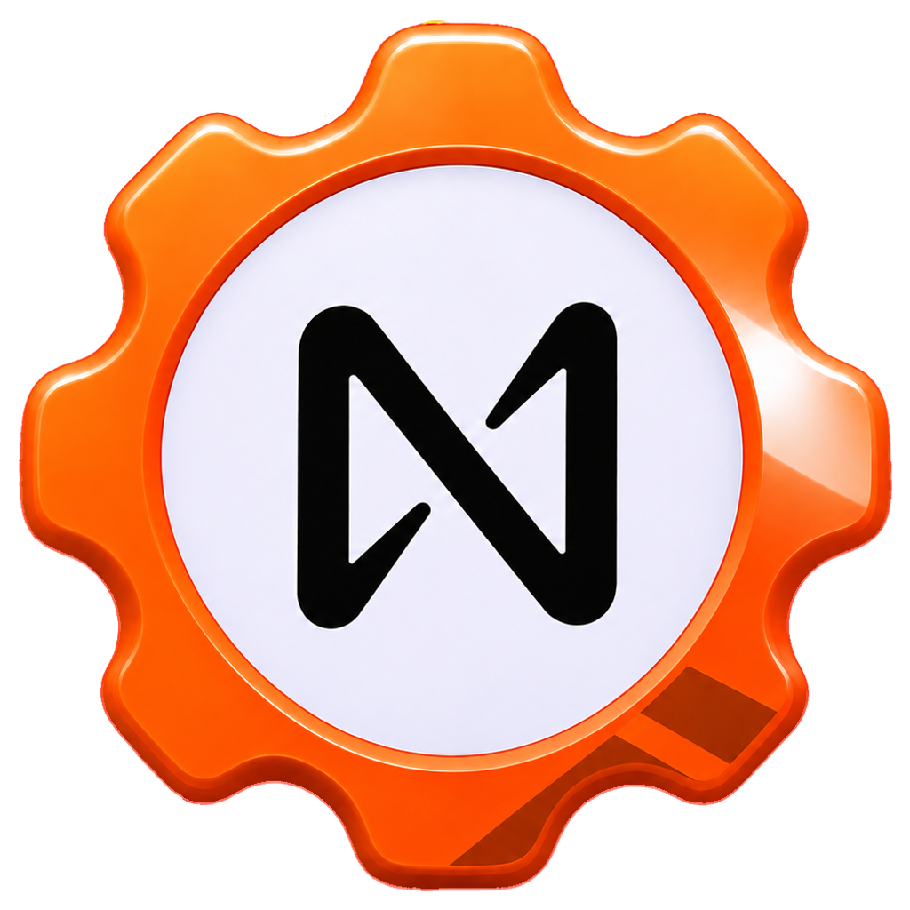

<p align="center">
  
</p>

<h1 align="center">NEAR Hardware</h1>

<p align="center">
  A DePIN &amp; IoT suite for NEAR Protocol: device firmware, a desktop app, and skills + MCP so any agent can set up NEAR hardware.
</p>

## What it is

NEAR Hardware connects physical devices (ESP32 boards, watches, Raspberry Pis) to NEAR. The goal: devices hold their own keys, sign NEAR transactions and Intents within on-chain spending limits, and coding agents like Claude Code and Codex customize device firmware through bundled skills and an MCP server.

**Status:** early development. The desktop app shell is in place; the contract, firmware, MCP server and skills are in progress.

## Repository layout

```
apps/desktop/   Electron + React + TypeScript desktop app
images/         Logo and artwork
```

More packages (contract, firmware, MCP server, skills) land as they're built.

## Development

Requires [Bun](https://bun.sh).

```sh
bun install
bun run dev        # start the desktop app with hot reload
bun run build      # typecheck and production build
```
