<p align="center">
  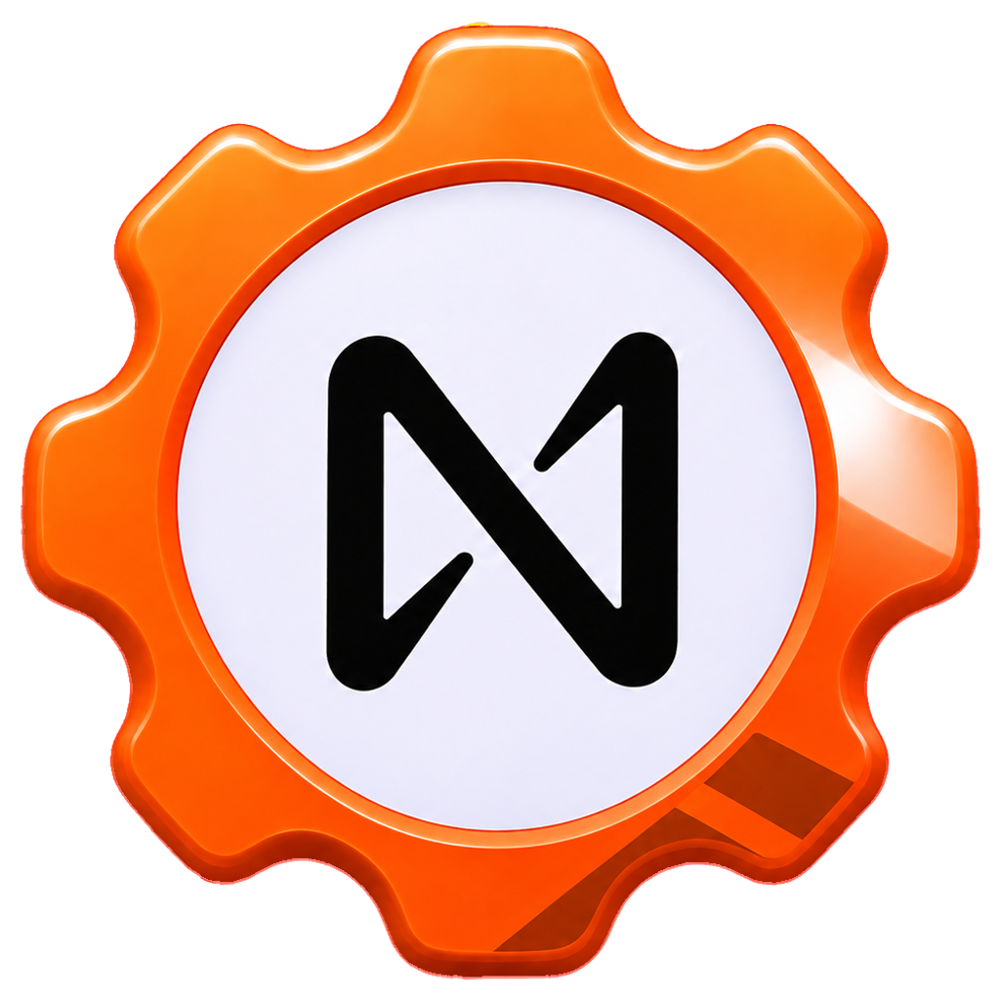
</p>

<h1 align="center">NEAR Hardware</h1>

<p align="center">
  <b>Turn any hardware into a NEAR device in minutes.</b><br/>
  The full AI hardware / DePIN suite for NEAR: plug in a board, describe what you want, and your coding agent builds it.
</p>

<p align="center">
  <a href="https://github.com/NEAR-Hardware/near-hardware/releases/latest"></a>
  
  
  
  <a href="LICENSE"></a>
  
</p>

<p align="center">
  
  
  
  
  
</p>

<p align="center">
  <a href="#install">Install</a> ·
  <a href="#see-it-at-work">See it at work</a> ·
  <a href="#two-devices-built-by-the-agent">Demos</a> ·
  <a href="#near-built-in">NEAR, built in</a> ·
  <a href="#try-it-in-10-minutes">Try it</a> ·
  <a href="media/near-hardware-launch.mp4">Launch video</a> ·
  <a href="JUDGES.md"><b>Judges &amp; AI reviewers</b></a>
</p>

<p align="center">
  <a href="media/near-hardware-launch.mp4"></a>
</p>

---

## What it is

Building a device that lives on NEAR (a wallet, a payment terminal, a sensor that pays or gets paid) takes five specialties at once: embedded firmware, key management, NEAR transactions, wallets and RPC, and NEAR's fast-moving docs. Coding agents can write the code, but out of the box they know neither your board nor NEAR, and they should never hold your keys.

**NEAR Hardware is a macOS app that turns the coding agent you already use into a NEAR hardware engineer.**

<table>
  <tr>
    <td width="33%" valign="top">
      <h3>🔌 It knows your board</h3>
      Plug in an ESP32, an Arduino, an STM32 (<b>1,500+ boards</b> through PlatformIO) or add a <b>Raspberry Pi over SSH</b>. The app detects it, and the agent sets it up from the manufacturer's own docs, then builds, flashes and tests on the device.
    </td>
    <td width="33%" valign="top">
      <h3>🧠 It knows NEAR</h3>
      Every agent gets <b>10 NEAR skills</b>, an <b>18-tool MCP server</b> and <b>465 pages of NEAR docs</b> it searches offline: accounts, contracts, NEAR Intents, Chain Signatures, NEAR AI, IronClaw, Agent Market and more.
    </td>
    <td width="33%" valign="top">
      <h3>🔐 It never sees your keys</h3>
      Your NEAR accounts live in the macOS Keychain and the app signs. Agents ask, you approve. For autonomy without risk they create <b>limited sub-accounts</b> whose keys can only call one contract.
    </td>
  </tr>
</table>

Bring your own agent: **Claude Code**, **Codex**, **OpenCode** or **Cursor**, signed in with your own account.

---

## See it at work

<p align="center">
  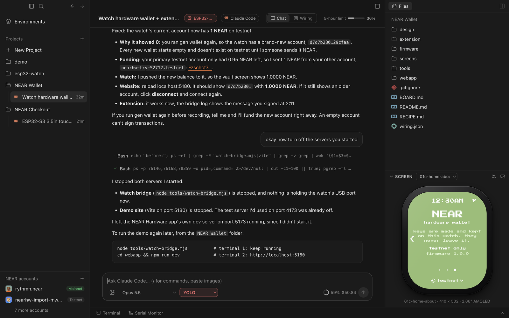
  <br/><sub><b>An agent building a NEAR hardware wallet.</b> The chat drives Claude Code; on the right, the project's files and a live preview of the watch's screen as the agent draws it.</sub>
</p>

<table>
  <tr>
    <td width="50%" valign="top">
      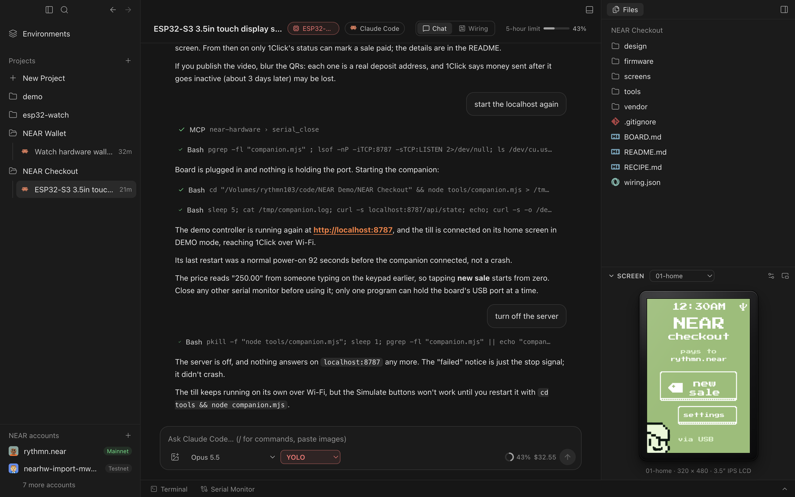
      <p align="center"><sub><b>Code, flash, test.</b> The agent runs the device and reports back; the screen preview cycles through every design.</sub></p>
    </td>
    <td width="50%" valign="top">
      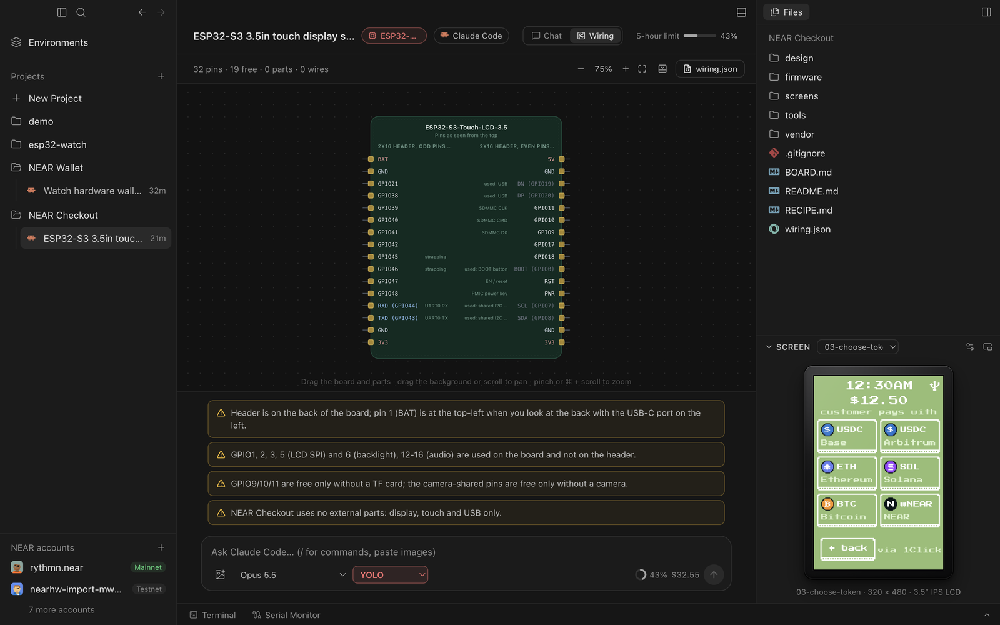
      <p align="center"><sub><b>Wiring whiteboard.</b> Every pin of the board, what's free, and how parts connect, drawn by the agent.</sub></p>
    </td>
  </tr>
  <tr>
    <td width="50%" valign="top">
      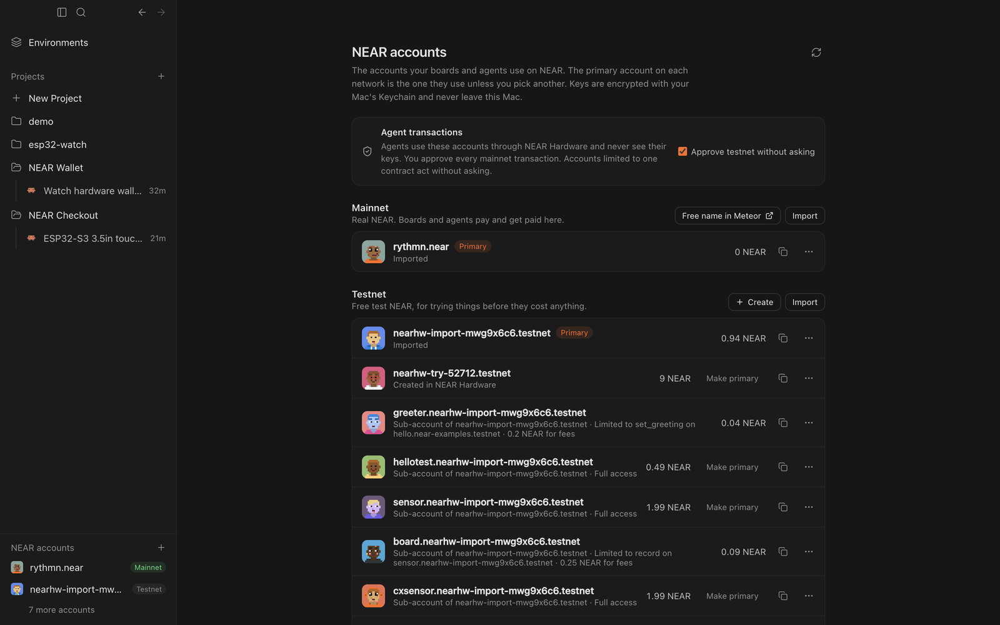
      <p align="center"><sub><b>Your NEAR accounts.</b> Mainnet and testnet side by side, each with its own pixel avatar, limited sub-accounts included.</sub></p>
    </td>
    <td width="50%" valign="top">
      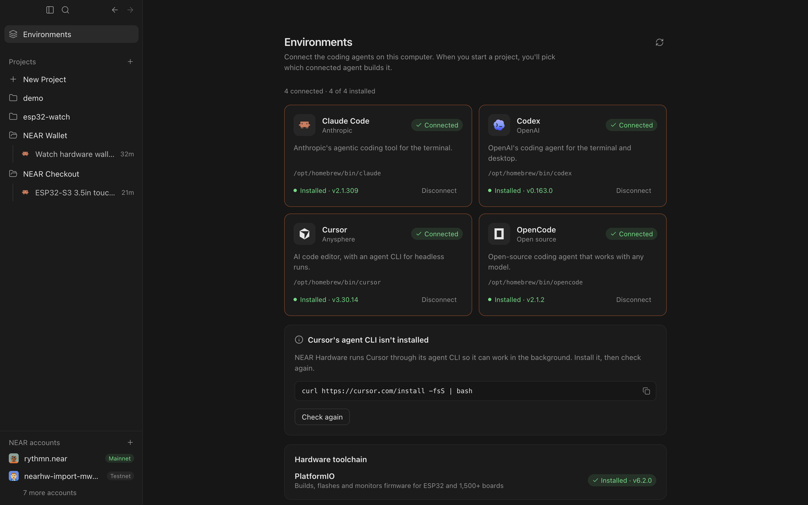
      <p align="center"><sub><b>Bring your own agent.</b> Claude Code, Codex, Cursor and OpenCode, detected and connected.</sub></p>
    </td>
  </tr>
  <tr>
    <td width="50%" valign="top">
      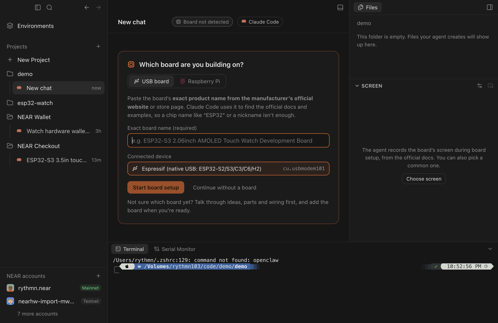
      <p align="center"><sub><b>Plug it in.</b> The board shows up the moment it's connected; type its name and the agent sets it up.</sub></p>
    </td>
    <td width="50%" valign="top">
      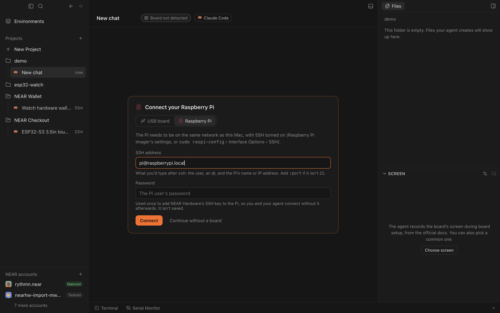
      <p align="center"><sub><b>Raspberry Pi over SSH.</b> The password is used once to install the app's key, never saved.</sub></p>
    </td>
  </tr>
</table>

---

## Two devices, built by the agent

Each demo was built **autonomously** inside NEAR Hardware: the board was plugged in, one Claude Code agent got one prompt, and it wrote the firmware and host software, flashed the board over USB, tested on the device and kept a reproducible build log. **Zero hand-written code.** Both have a safe testnet (or demo) version and a mainnet version. Details: **[demos/](demos/)**.

<table>
  <tr>
    <th width="50%">🪪 <a href="demos/near-wallet/">NEAR Hardware Wallet</a></th>
    <th width="50%">🧾 <a href="demos/near-checkout/">NEAR Checkout</a></th>
  </tr>
  <tr>
    <td align="center">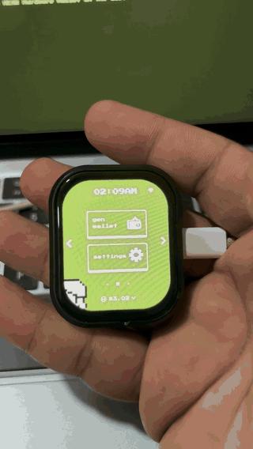</td>
    <td align="center">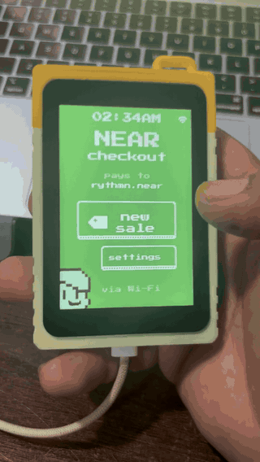</td>
  </tr>
  <tr>
    <td valign="top">
      A hardware wallet on an <b>ESP32-S3 smartwatch</b>.
      <ul>
        <li>The key is generated on the watch and never leaves it</li>
        <li>A Chrome extension adds the watch to <b>NEAR Connect</b> on any site</li>
        <li>Every signature is approved on the watch with a PIN</li>
        <li>A real testnet transaction signed on the wrist: <a href="https://testnet.nearblocks.io/txns/CPtV4ezeP5tpNaKdSQgyGtzdHx6T7fCezTdKWNCbq4G6"><code>CPtV4ezeP5…</code></a></li>
      </ul>
      <a href="demos/near-wallet/demo.mp4">▶ Full video</a> · <a href="demos/near-wallet/README.md">Run it</a>
    </td>
    <td valign="top">
      A point-of-sale till on an <b>ESP32-S3 3.5" touch display</b>.
      <ul>
        <li>The customer pays from any chain: ETH, SOL, BTC, USDC on Base or Arbitrum, NEAR</li>
        <li><b>NEAR Intents (1Click)</b> settles it as USDC in the merchant's NEAR account</li>
        <li>Every quote's signature is verified on the device before the QR is shown</li>
        <li>From empty folder to a working till in about 50 minutes</li>
      </ul>
      <a href="demos/near-checkout/demo.mp4">▶ Full video</a> · <a href="demos/near-checkout/README.md">Run it</a>
    </td>
  </tr>
</table>

<p align="center">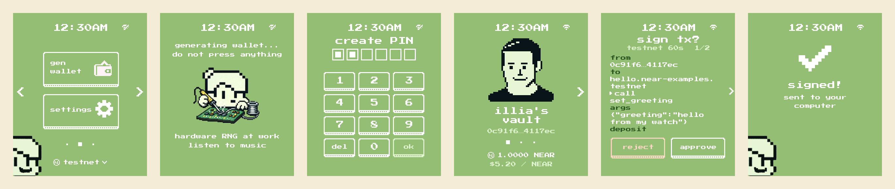<br/><sub>The watch wallet's screens, drawn by its own firmware: home, generating a key with the hardware RNG, PIN, vault, transaction review, signed.</sub></p>

<p align="center">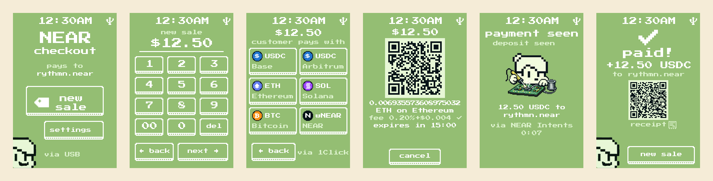<br/><sub>The checkout's screens: home, price, choose a token, NEAR Intents quote with a payment QR, payment seen, paid.</sub></p>

---

## NEAR, built in

| | What the app does |
| --- | --- |
| **Accounts** | Free named testnet accounts from the faucet in one click; import any mainnet or testnet wallet from its 12 words or private key (BIP39 + SLIP-10 ed25519, the same standard as Meteor and other NEAR wallets). |
| **Signing** | Transactions are built and signed inside the app (Borsh, nonce tracking, FastNEAR RPC). Agents never see a key; every mainnet action asks you first in a native prompt. |
| **Limited sub-accounts** | Agents and boards get accounts like `bot.you.testnet` whose function-call key can only reach one contract's chosen methods, with a fee allowance that NEAR itself enforces. |
| **Smart contracts** | Setup installs Rust, wasm32, cargo-near and NEAR CLI; agents write, test, build and deploy Rust contracts with your approval. |
| **NEAR Intents** | Cross-chain payments through 1Click: exact-output quotes, deposit addresses, status and signature checks (see the checkout). |
| **NEAR Connect** | Web apps with NEAR wallet login and NEP-413 message signing (see the wallet's extension). |
| **And more** | Skills for Chain Signatures, NEAR AI Cloud, IronClaw and the NEAR Agent Market, with their docs bundled. |

**The MCP tools every agent gets:** `near_accounts`, `near_account_info`, `near_view`, `near_transfer`, `near_call`, `near_deploy_contract`, `near_create_subaccount`, `near_add_limited_key`, `near_docs_search`, `near_docs_read`, `read_skill`, plus board detection and serial tools.

---

## Install

> **Platforms:** macOS on Apple silicon today. **Windows and Linux support is coming soon.**

On a Mac with Apple silicon (M1 or later, macOS 12+), in Terminal:

```sh
curl -fsSL https://raw.githubusercontent.com/NEAR-Hardware/near-hardware/main/install.sh | bash
```

It installs NEAR Hardware in Applications and opens it on a guided setup: your coding agent, your NEAR accounts, the Rust contract toolchain, PlatformIO and a projects folder. The script downloads with `curl`, so macOS opens the app without a warning.

Prefer a disk image? `NEAR-Hardware-mac-arm64.dmg` is on [Releases](https://github.com/NEAR-Hardware/near-hardware/releases/latest). The app isn't notarized yet, so a browser download asks once: System Settings › Privacy & Security › **Open Anyway**.

From source, with [Bun](https://bun.sh): `bun install && bun run dev`.

---

## Try it in 10 minutes

No hardware needed for steps 1 to 4.

1. **Install** and follow the setup guide: connect Claude Code or Codex, and let it install the contract toolchain.
2. **Create a testnet account:** type a name in the NEAR accounts step → `name.testnet` appears at the bottom of the sidebar with its pixel avatar and 10 free testnet NEAR.
3. **New Project** → **New chat** → **Continue without a board**, then ask: *"Read the near-contracts skill, write a Rust counter contract, deploy it to a new sub-account of my testnet account, and call increment."* → approve the prompts → the chat shows the transactions with explorer links.
4. **Ask a NEAR question:** *"Use near_docs_search: how does a 1Click EXACT_OUTPUT quote work?"* → answered from the bundled docs, offline.
5. **With a board:** plug it in, start a new chat → it's detected → type its product name → **Start board setup**. Then build one of the [demos](demos/).

---

## For judges and AI reviewers

**[JUDGES.md](JUDGES.md)** has the quickest setup, checks that run without the GUI, a map of every feature to its code with how to verify it and its test status, every NEAR integration, and the hackathon disclosures.

---

## Under the hood

```
apps/desktop/                                  Electron + React + TypeScript desktop app
apps/desktop/src/main/near/                    NEAR accounts, keys, RPC, transactions, approvals, agent tools
apps/desktop/resources/skills/                 The 10 NEAR skills every agent gets
apps/desktop/resources/near-docs/              465 pages of NEAR, Intents, NEAR AI, IronClaw and Agent Market docs
apps/desktop/resources/near-hardware-mcp.mjs   The MCP server every agent gets (its tools run in the app)
demos/                                         The wallet and checkout, built autonomously in the app
media/                                         The launch video
```

Development with [Bun](https://bun.sh): `bun install`, `bun run dev` (hot reload), `bun run build` (typecheck and production build), `cd apps/desktop && bun run build:mac` (DMG and zip; signed and notarized when a Developer ID and the `APPLE_*` variables are present).

---

## Built at NEAR HACKATHON

Built for [NEAR HACKATHON](https://nearhackathon.com) in November 2026, with AI coding agents. Main libraries: Electron, electron-vite, React, Vite, TypeScript, the Claude Agent SDK, node-pty, serialport, xterm.js, Monaco Editor, @scure/bip39. The demos use PlatformIO with the Arduino core for ESP32, ArduinoJson, Arduino_GFX, qrcodegen, near-api-js, NEAR Connect and the 1Click SDK. File icons from [file-icons](https://github.com/file-icons/vscode) (MIT); agent logos from [simple-icons](https://simpleicons.org) (CC0) and [lobehub icons](https://github.com/lobehub/lobe-icons) (MIT), owned by their makers.

[MIT License](LICENSE)
