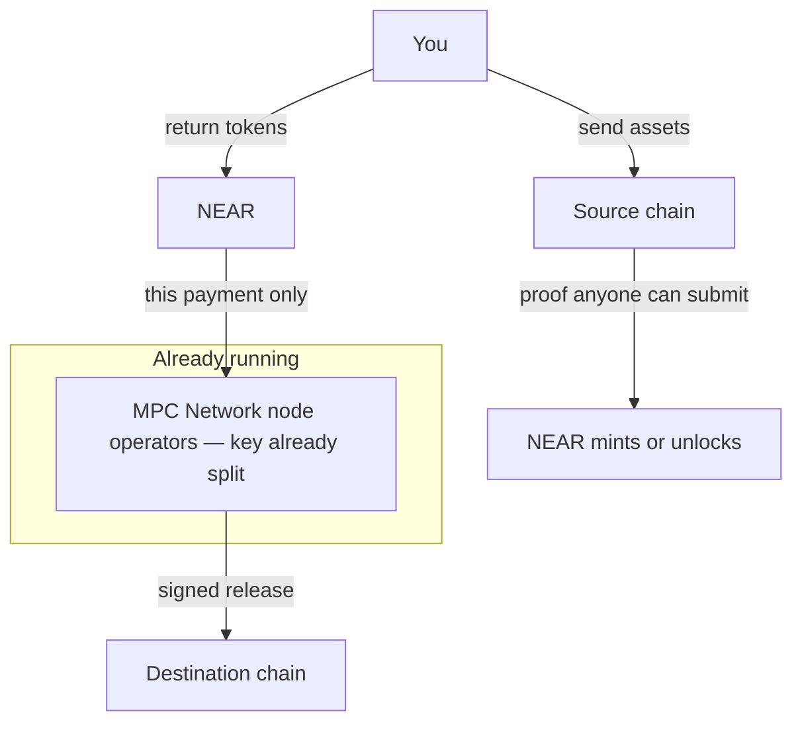

> ## Documentation Index
> Fetch the complete documentation index at: https://docs.near-intents.org/llms.txt
> Use this file to discover all available pages before exploring further.

# Omni Bridge

> How Omni Bridge moves assets on and off NEAR, and why Bitcoin works differently

Omni Bridge is how Bitcoin, Ethereum, Solana, and a few other chains move in and out of NEAR Intents. Near One runs it. It is not HOT Bridge and not the POA Bridge.

Two different jobs, two different actors:

* A **relayer** carries a message or a proof between chains. Relayers cannot mint, steal, or rewrite a transfer. If one disappears, another can do the same job — or you can.
* **[MPC Network](https://docs.near.org/chain-abstraction/chain-signatures) node operators** jointly hold the bridge key. They are already running. They are not started when you ask for an address. They only sign when assets **leave** NEAR.

## Coming in vs going out

**Onto NEAR**, the bridge checks a proof from the source chain. For Bitcoin and Ethereum that is a [light client](https://ethereum.org/developers/docs/nodes-and-clients/light-clients/): software on NEAR that can verify that chain's history without running a full node. For Solana and several EVM L2s it is [Wormhole](https://wormhole.com/), a message-passing network those chains already use. Anyone can submit the proof. A relayer usually does this for you.

**Off NEAR**, [MPC Network](https://docs.near.org/chain-abstraction/chain-signatures) node operators have to sign a payment on the destination chain. No single operator holds the full key. Fragments combine into one ordinary signature (threshold MPC). Relayers only carry the signed message. They cannot produce it.

Asking for a deposit address does **not** start the operators and does **not** request a signature. Address derivation is calculated from a public key.

The operator box is not on the deposit path. It only appears when assets leave NEAR.

## Bitcoin is different

Bitcoin deposits are not swept into a shared vault. Each deposit gets its own address, and the coins sit there until a withdrawal spends them. That is the part most people want to understand if they sent BTC.

> [card] [How the Bitcoin side works](https://docs.near-intents.org/learn/omni-bridge/how-it-works.md)
>
> Where your deposit address comes from, why there is no vault, and who can sign a withdrawal

## Chains Intents uses it for

Ethereum, Base, Arbitrum, BNB, Solana, and Bitcoin.

Other Intents chains use [POA Bridge](https://docs.near-intents.org/integration/bridging/overview.md#poa-bridge) or [HOT Bridge](https://docs.near-intents.org/integration/bridging/overview.md#hot-bridge).

This documentation is built and hosted on [Mintlify](https://mintlify.com), a developer documentation platform.