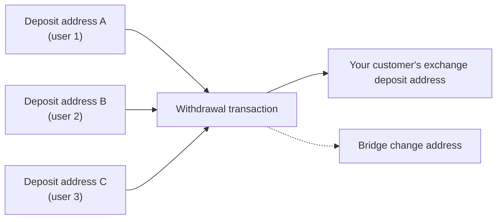

> ## Documentation Index
> Fetch the complete documentation index at: https://docs.near-intents.org/llms.txt
> Use this file to discover all available pages before exploring further.

# Withdrawals to Exchanges

> How to read a Bitcoin or Zcash withdrawal from NEAR Intents when it arrives at an exchange deposit address, and what to do when a transaction-monitoring tool flags one of its inputs

This page is for exchange risk and compliance teams, and for partners whose user's deposit was held after withdrawing from NEAR Intents. It explains why a withdrawal from NEAR Intents on a UTXO chain shows inputs from several unrelated addresses, how to recognise one, and what to ask us for.

> [!NOTE]
>
> On account-based chains (EVM, Solana, TON, and others) a withdrawal from NEAR Intents is a transfer from a listed [treasury address](https://docs.near-intents.org/security-compliance/treasury-addresses.md). The rest of this page is about Bitcoin and Zcash, where the bridge spends deposits directly and the shape of the transaction is different.

## What a withdrawal looks like on chain

NEAR Intents holds Bitcoin and Zcash through [Omni Bridge](https://docs.near-intents.org/learn/omni-bridge/overview.md). The bridge does not sweep deposits into a vault. Each user gets a dedicated, single-use deposit address, and the coins stay there until a withdrawal spends them. A withdrawal to your customer's deposit address is built from whichever deposit outputs fit the amount, so it typically has:

* **Several inputs**, each a single-use NEAR Intents deposit address funded by a different user.
* **One output** to the recipient your customer specified.
* **One change output** to a fixed bridge change address (listed below).

The inputs are not the withdrawing customer's wallets and are not their counterparties. The customer deposited to their own address, swapped or transferred inside NEAR Intents, and asked for a withdrawal. The bridge chose the inputs. The customer's own deposited coins are often not among them.

Why the bridge works this way is covered in [How the Bitcoin bridge works](https://docs.near-intents.org/learn/omni-bridge/how-it-works.md#2-why-there-is-no-vault).

## What this means for screening

**A risk score on an input is about the depositor of that input, not about your customer.** If a monitoring tool flags one input address, the exposure it found arrived with another user's deposit. Your customer had no relationship with that address and no way to influence which inputs funded their withdrawal.

**Deposit addresses are single use.** An input address is funded once and spent once. Whitelisting it has no effect because it will not receive funds again. The stable identifiers for the bridge are the change addresses below.

**The transaction is a plain payment.** One recipient output plus change. It is not a CoinJoin and no mixer or tumbler is involved; the multiple-input shape comes from the bridge's custody model.

**Deposits into NEAR Intents are screened.** Every deposit is checked against the providers listed on the [Risk & Compliance](https://docs.near-intents.org/security-compliance/risk-and-compliance.md) page before it is credited. Funds that fail screening are held apart and not used in regular operations.

## How to recognise a NEAR Intents withdrawal

Check the change output. A withdrawal from NEAR Intents sends its remainder to one of these bridge-controlled addresses, which are reused across every withdrawal:

| Network | Omni Bridge change address |
| - | - |
| **Bitcoin (BTC)** | [`bc1qp42j7hn3lup7gck6y6eks6x2lmnp800t6gy7sk`](https://mempool.space/address/bc1qp42j7hn3lup7gck6y6eks6x2lmnp800t6gy7sk) |
| **Zcash (ZEC)** | [`t1KfwsnwJeNRVjQGBDZhwKskpQbih2qx5Ua`](https://mainnet.zcashexplorer.app/address/t1KfwsnwJeNRVjQGBDZhwKskpQbih2qx5Ua) |

A transaction whose change goes to one of these addresses was constructed and signed by Omni Bridge on behalf of a NEAR Intents user. You can also recalculate any deposit address from the bridge's public key and the depositor's request; see [how deposit addresses are derived](https://docs.near-intents.org/learn/omni-bridge/how-it-works.md#1-your-bitcoin-gets-an-address-of-its-own).

## What to send us

We can attribute any withdrawal to the NEAR Intents account that initiated it and show the settlement on NEAR. Send:

* The transaction hash on Bitcoin or Zcash.
* Your deposit address that received the output.
* If a partner raised the case, the 1Click `correlationId` from the swap status response.

> [!NOTE]
>
> A compliance contact for exchange enquiries is being set up. Until it is published here, reach the team through the [NEAR Intents Telegram](https://t.me/near_intents) or your existing partnership contact.

## Related

> [card] [Risk & Compliance](https://docs.near-intents.org/security-compliance/risk-and-compliance.md)
>
> Which screening providers deposits are checked against

> [card] [Treasury Addresses](https://docs.near-intents.org/security-compliance/treasury-addresses.md)
>
> Treasury, refill, and bridge change addresses by network

> [card] [How the Bitcoin bridge works](https://docs.near-intents.org/learn/omni-bridge/how-it-works.md)
>
> Why deposits are spent directly rather than swept into a vault

This documentation is built and hosted on [Mintlify](https://mintlify.com), a developer documentation platform.