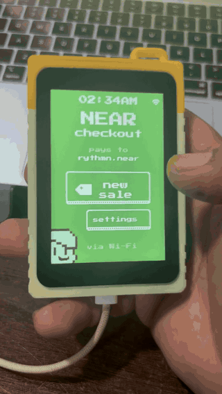

# NEAR Checkout

<p align="center"></p>
<p align="center"><a href="demo.mp4">Full video (1:04, MP4)</a>: type a price, pick a token, get a NEAR Intents quote and QR, payment seen, paid in USDC to the merchant's NEAR account.</p>

A point-of-sale till on the Waveshare **ESP32-S3-Touch-LCD-3.5** (320×480 touch screen). The merchant types a price, the customer picks how to pay (USDC on Base, USDC on Arbitrum, ETH, SOL, BTC or NEAR), and the till shows a QR for a real **NEAR Intents 1Click** quote. However the customer pays, the merchant receives exactly the price as **USDC on NEAR** (default `rythmn.near`). It has the NEAR Wallet look: green screen, pixel font, pixel buttons, clock, mascot.

```
firmware/   PlatformIO firmware (UI, 1Click quotes/status, quote signature check, USB protocol, Wi-Fi)
firmware/sim  host build of the same UI + logic: tests, and renders every screen to screens/
tools/      companion.mjs (USB relay + demo controller), check-live.mjs, e2e-demo.mjs
screens/    every till screen, drawn by the firmware's own code
BOARD.md    the board: pins, chips, sources.  RECIPE.md: how this was built, versions, pitfalls
```

## How this was made

**Built autonomously in the NEAR Hardware app, with zero hand-written code.** The board was plugged in over USB and the app detected it; one Claude Code agent (Opus 5.5) got one prompt, plus one follow-up message asking it to drop placeholder "demo" wording from the sale screens. On its own it:

- learned NEAR Intents from the app's custom NEAR skills (`near-intents`, `near-devices`, `near-accounts`) and the bundled 1Click docs through the NEAR Hardware MCP server, then checked every asset against the live `/v0/tokens` list instead of guessing;
- wrote 3,842 lines of firmware (a 320×480 pixel UI of 17 screens, 1Click quotes and status over its own HTTPS or relayed over USB, **ed25519 verification of every 1Click quote on the device** before a deposit address is shown, EIP-681 / BIP-21 / Solana Pay payment QR codes) and 863 lines of companion, demo controller and tests;
- found that 1Click's quote signature never verifies for BTC quoted as `nep141:btc.omft.near`, not even with the official SDK, traced it to the id 1Click actually signs (`1cs_v1:btc:native:coin`) and switched to it, so BTC quotes verify too;
- flashed the board, then ran complete sales on the device by tapping the touchscreen over USB (price → token → QR → paid, and an expired sale), and checked the mainnet path with real quotes without moving funds.

Nobody wrote code or pressed a button on the board. `RECIPE.md` is the agent's own build log, about 50 minutes from empty folder to working till.

## How a sale works

1. **new sale** → type the price → **next** → the customer picks a token.
2. The till asks 1Click for an `EXACT_OUTPUT` quote: the merchant gets exactly the price in USDC on NEAR (`nep141:17208628…33a1`). Refunds go to the merchant's NEAR Intents balance (`refundType: "INTENTS"`), because a till doesn't know the customer's address.
3. The till checks 1Click's ed25519 signature on the quote itself and only then shows the deposit address. The QR is a wallet payment request: EIP-681 for USDC/ETH, BIP-21 for BTC, Solana Pay for SOL, the bare account for wNEAR (NEAR has no payment-URI standard). Next to it: the exact amount, chain, fee and a countdown to the quote deadline (15 min, 60 min for BTC).
4. **payment seen** (mascot at work) → **paid!** with the USDC received and a receipt QR that opens `explorer.near-intents.org/transactions/<deposit address>`. Or **expired**, **refunded**, **incomplete** or **failed**.

## Two versions: Demo and Mainnet (Settings)

NEAR Intents has no testnet (1Click runs on mainnet only), so the safe version of this demo is **Demo**: no money moves, and the payment is simulated from the Mac. **Mainnet** (LIVE) takes real payments. One firmware has both; you switch in Settings on the till.

Both modes show exactly the same screens with a **real** 1Click quote and a real deposit address, so a demo looks like a real sale on camera. A real payment to that QR really pays the merchant in either mode, and the till keeps polling `/v0/status` in both.

- **DEMO** (default): the Mac demo controller decides how the sale ends: **Simulate payment received** or **Simulate expired**.
- **LIVE**: only 1Click's `/v0/status` marks a sale paid; the controller's buttons are refused. Turning LIVE on asks for confirmation on the till (a "real money" screen). Switching back to DEMO is one tap.

The mode is shown only in **Settings** on the till and on the demo controller page, never on the sale screens. DEMO can mark a sale paid when nothing was paid, so don't use DEMO with real customers.

## Demo version: start here, no money moves (over USB; Wi-Fi optional)

You need the board, [PlatformIO](https://platformio.org/install/cli) and Node 20+. From the repository root (find the board's port with `pio device list`; it's `/dev/cu.usbmodem101` below):

```sh
cd demos/near-checkout/firmware && pio run -t upload --upload-port /dev/cu.usbmodem101   # once
cd ../tools && npm install                                                              # once
node companion.mjs                                                                       # keep it running
```

Open **http://localhost:8787**: the demo controller. It shows what the till shows (with a live mirror of its screen), and has two big buttons (keys **P** and **E**):

- start a sale on the till: **new sale** → `12.50` → **next** → **ETH**
- when the QR is up, press **Simulate payment received** → the till shows *payment seen*, *swapping to USDC*, then **paid!**
- or press **Simulate expired** → **expired**

Close any other serial monitor first (only one program can hold `/dev/cu.usbmodem101`). `node e2e-demo.mjs` runs both sales automatically by tapping the till over USB and saves device screenshots to `tools/screenshots/`.

Publishing a video? Every QR on screen is a real deposit address. Payments before the deadline go to the merchant, but 1Click says funds sent after the address goes inactive (`quote.deadline`, about 3 days later) "may be lost". Blur the QR if the video will outlive that.

## Mainnet version: go live (real money)

1. Settings → **merchant** → type the NEAR account that should receive USDC (it must exist on mainnet) → **save**.
2. Wi-Fi: the till joins the network in `firmware/include/secrets.h` (git-ignored: copy `secrets.example.h` to it, fill in `WIFI_SSID` / `WIFI_PASSWORD`, and flash again) and then reaches 1Click on its own. Without Wi-Fi, keep `node tools/companion.mjs` running; it relays the same 1Click messages over USB.
3. Optional: a 1Click partner key (https://partners.near-intents.org/) lowers the fee: `ONECLICK_API_KEY` in `secrets.h` (Wi-Fi) or in `tools/.env` (companion). Never commit it.
4. Settings → **LIVE** → read the screen → **go live**.
5. Test with a small amount first. `node tools/check-live.mjs` checks the mainnet path from the Mac without moving funds: assets listed, dry quotes for all six, one real (unfunded) quote with its signature checked by the SDK and by the till's own verifier, and a status call.

The companion saves every quote it relays to `tools/receipts/<deposit address>.json` (git-ignored). 1Click asks integrators to keep the signed quote to resolve disputes.

## Without the board

- `screens/` has every till screen, drawn by the firmware's own code.
- The simulator builds the same UI and 1Click logic on the Mac, runs its tests and re-renders `screens/`: `brew install libsodium`, then `cd firmware && pio pkg install && cd sim && make`.
- `cd tools && npm install && node check-live.mjs` checks the mainnet path without moving funds (assets, dry quotes, one unfunded real quote and its signature, a status call).

## USB protocol

USB-Serial-JTAG, 115200 baud, one JSON object per line. The host keeps DTR high and never raises RTS with DTR low (that resets the chip). Requests carry an `id` that the answer echoes.

| Host → till | Answer |
|---|---|
| `{"id":1,"cmd":"hello","time":<unix s>,"utcOffset":<min east>}` | `{"ok":true,"device":"NEAR Checkout","fw":"1.0.0","wifi":…,"boot":{reset, pmu},"state":{…}}`; sets the clock (also kept in the RTC). The companion sends it every 2 s as a heartbeat. |
| `{"id":2,"cmd":"state"}` | `{"ok":true,"state":{"screen":"quote","mode":"demo","price":"12.50","symbol":"ETH","amountIn":"0.0069…","depositAddress":"0x…","qr":"ethereum:…","verified":true,"expiresIn":897,…}}` |
| `{"cmd":"http_result","rid":7,"status":201,"body":"<1Click's answer, verbatim>"}` | none: the answer to the till's `http` event |
| `{"id":3,"cmd":"demo","action":"paid"}` / `"expire"` | `{"ok":true}`, or `live_mode` / `no_open_quote` |
| `{"id":4,"cmd":"tap","x":160,"y":272}` | `{"ok":true}`: a tap, as if a finger pressed there |
| `{"id":5,"cmd":"set_merchant","account":"shop.near"}` | `{"ok":true}` or `bad_account` |
| `{"id":6,"cmd":"set_mode","mode":"demo"}` | `{"ok":true}`; `"live"` is refused (`confirm_live_on_the_till`) |
| `{"id":7,"cmd":"shot"}` | the framebuffer as RLE/base64 rows, then `{"ok":true}` |

| Till → host event | |
|---|---|
| `{"event":"http","rid":7,"method":"POST","path":"/v0/quote","body":"{…}"}` | tethered mode: the companion fetches `https://1click.chaindefuser.com` + path (only `/v0/quote`, `/v0/status?depositAddress=…`, `/v0/tokens`) and answers `http_result` |
| `{"event":"state",…}` | on every screen change |
| `{"event":"boot","fw":"1.0.0","boot":{…}}` | at start-up |
