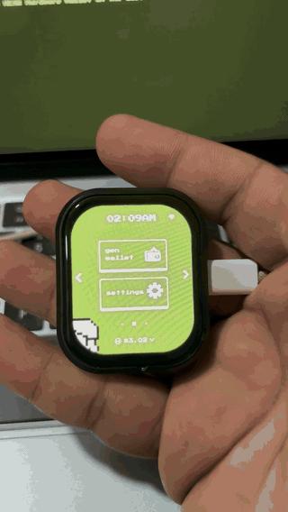

# NEAR Hardware Wallet on a watch

<p align="center"></p>
<p align="center"><a href="demo.mp4">Full video (1:11, MP4)</a>: create a wallet on the watch, connect it to a site through NEAR Connect, approve a transaction with the PIN.</p>

A NEAR hardware wallet (testnet or mainnet, chosen when you build the firmware) on the Waveshare **ESP32-S3 2.06" AMOLED Touch Watch**. The key is generated on the watch and never leaves it. A Chrome extension adds the watch to **NEAR Connect**'s wallet list on any site, and every signature is approved on the watch with a 6-digit PIN.

```
firmware/   PlatformIO firmware for the watch (UI, BIP39/SLIP-10 keys, PIN-encrypted storage, serial protocol)
extension/  Chrome MV3 extension "NEAR Hardware Wallet" (Load unpacked → this folder)
webapp/     Vite test site: NEAR Connect, balance, set_greeting, NEP-413 sign message
tools/      Node tools: watch-sign.mjs (end-to-end tx), watch-e2e.mjs, extension build + smoke test
screens/    Every watch screen, rendered by the firmware's own drawing code (firmware/sim); screens/mainnet/ for the mainnet build
design/     The reference designs
```

## How this was made

**Built autonomously in the NEAR Hardware app from exactly one prompt, with zero hand-written code.** The watch was plugged in over USB and the app detected it; one Claude Code agent (Opus 5.5) did everything else on its own:

- learned NEAR from the app's custom NEAR skills (`near-devices`, `near-accounts`, `near-web-apps`, `near-subaccounts`) and the 465 bundled NEAR docs pages through the NEAR Hardware MCP server (NEAR Connect, Borsh transactions, NEP-413);
- wrote 4,718 lines of firmware (hardware RNG → BIP39 → SLIP-10 ed25519, AES-256-GCM key storage behind a PIN, an on-device Borsh transaction decoder, a pixel UI of 26 screens) and 1,424 lines of Chrome extension, NEAR Connect test site and tools;
- flashed the watch over USB, funded its account with NEAR Hardware's own `near_transfer` tool, and had it sign a real testnet transaction: [`CPtV4ezeP5tpNaKdSQgyGtzdHx6T7fCezTdKWNCbq4G6`](https://testnet.nearblocks.io/txns/CPtV4ezeP5tpNaKdSQgyGtzdHx6T7fCezTdKWNCbq4G6);
- solved the hard parts itself: the ESP32-S3's USB serial held replies until the host wrote again, so it bypassed the Arduino and ESP-IDF drivers and drives the USB-Serial-JTAG hardware FIFOs directly, in packets of at most 63 bytes.

The only touches on the watch were a person approving signatures with the PIN, which is what a hardware wallet is for. `RECIPE.md` is the agent's own build log. (The mainnet build option was added afterwards.)

## Testnet (start here)

1. **Flash the watch**: `cd firmware && pio run -e testnet -t upload --upload-port /dev/cu.usbmodem101` (`testnet` is the default env, so plain `pio run` builds it too)
2. **Make a wallet on the watch**: gen wallet → write down the 12 words → choose a 6-digit PIN. Fund the account it shows on testnet.
3. **Load the extension**: `cd tools && npm install && node build-extension.mjs`, then in Chrome open `chrome://extensions` → turn on **Developer mode** → **Load unpacked** → pick the `extension/` folder.
4. **Run the test site**: `cd webapp && npm install && npm run dev`, open http://localhost:5173 → **connect wallet** → pick **NEAR Hardware Wallet** → **connect watch** (first time only: choose the "USB JTAG/serial debug unit") → **set greeting** on `hello.near-examples.testnet` → approve on the watch.
5. Optional, from Node: `cd tools && node watch-sign.mjs` and `node watch-e2e.mjs`.

Close any serial monitor that holds `/dev/cu.usbmodem101` first: only one program can talk to the watch at a time.

## Mainnet

> **Demo grade.** Flash encryption and secure boot are off, so anyone holding the watch can dump its flash and brute-force the 6-digit PIN offline. Keep only a few NEAR on it and never type in words that guard real funds. The mainnet firmware says so on its about page and in settings.

1. **Flash the mainnet build**: `cd firmware && pio run -e mainnet -t upload --upload-port /dev/cu.usbmodem101`. It answers `"network":"mainnet"` to `info` and refuses testnet requests with `network_not_allowed`.
2. **Wallet**: flashing keeps the wallet stored on the watch, so the same key and implicit account carry over to mainnet. For a fresh key, settings → wipe, then gen wallet. Fund the account with a little real NEAR (set greeting only costs gas).
3. **Extension**: the same build as for testnet, nothing to change. It reads the network from the watch's `info`, offers itself to NEAR Connect on both networks, refuses requests for the network the watch doesn't sign for, and uses `rpc.mainnet.fastnear.com` and nearblocks.io.
4. **Test site**: `cd webapp && npm run dev:mainnet` (the same as `VITE_NEAR_NETWORK=mainnet npm run dev`; `npm run build:mainnet` for a build). It calls `set_greeting` on `hello.near-examples.near` with no deposit.
5. Optional, from Node: `cd tools && node watch-sign.mjs --network mainnet` and `node watch-e2e.mjs --network mainnet`.

To go back, flash `-e testnet` and run the site with `npm run dev`.

## Serial protocol

USB serial (USB-Serial-JTAG), 115200 baud, one JSON object per line, UTF-8. The host must assert **DTR** (the S3 only sends while DTR is set) and must never set RTS high with DTR low (that resets the chip). Every request may carry an `id` (number or string), echoed in its answer. Answers have `ok`; progress events have `event` instead. Lines that don't start with `{` (boot ROM messages) can be ignored. Empty lines are ignored.

| Request | Answer |
|---|---|
| `{"id":1,"cmd":"ping"}` | `{"id":1,"ok":true,"pong":true}` |
| `{"id":2,"cmd":"info"}` | `{"id":2,"ok":true,"device":"NEAR watch wallet","fw":"1.0.0","state":"no_wallet"\|"locked"\|"ready","busy":false,"setup":false,"network":"testnet"\|"mainnet","publicKey":"ed25519:…","accountId":"<64 hex>"}` |
| `{"id":3,"cmd":"sign_tx","tx":"<base64 Borsh Transaction>","network":"testnet","timeout":120}` | event `{"id":3,"event":"review","timeout":120}` as soon as the watch shows it, then `{"id":3,"ok":true,"signature":"<base64, 64 bytes>","hash":"<base58 tx hash>","publicKey":…,"accountId":…}` |
| `{"id":4,"cmd":"sign_message","message":"…","recipient":"…","nonce":"<base64, 32 bytes>","callbackUrl":"…"}` | event `review`, then `{"id":4,"ok":true,"signature":"<base64>","publicKey":…,"accountId":…}` (NEP-413) |
| `{"id":5,"cmd":"cancel"}` | cancels the request on screen (it answers `cancelled`), then `{"id":5,"ok":true,"cancelled":true}` |
| `{"id":6,"cmd":"set_status","time":<unix s>,"utcOffset":<minutes east of UTC>,"balance":"<yocto>","price":3.25}` | `{"id":6,"ok":true}`: sets the clock (kept in the RTC), balance and NEAR price on the vault screen |
| `{"id":7,"cmd":"selftest"}` | derives the fixed test phrase without storing it: `{"ok":true,"pass":true,"expected":"ed25519:r4yu…","publicKey":"ed25519:r4yu…","deriveMs":190,"pinKdfMs":1134}` |

- `network` is the network the firmware was built for. `sign_tx` and `sign_message` must name that network (a request without `network` counts as testnet).
- `sign_tx`: the watch decodes the transaction and shows signer, receiver and every action (transfer amount in NEAR, function call method + args + deposit + gas, add/delete key with limits, delete account, deploy, stake, meta-tx). Actions it can't decode show the SHA-256 to compare instead. It signs `ed25519(sha256(tx bytes))` after **approve** + PIN.
- `sign_message`: shows recipient, message and nonce; signs `sha256(borsh(2^31+413) ‖ borsh({message, nonce, recipient, callbackUrl}))`.
- Errors: `{"ok":false,"error":…}` with `rejected`, `timeout` (default 120 s, 10–600), `cancelled`, `busy` (one request at a time), `no_wallet`, `setup_in_progress`, `wrong_key` (tx key isn't the watch's), `bad_tx`, `network_not_allowed` (not this build's network), `too_large` (tx > 24 KB), `bad_json`, `bad_request`, `unknown_command`, `wiped`.
- The secret seed and private key are never sent or printed. A `{"event":"boot",…}` line is printed at start-up.

## Keys and security

- 128 bits from the ESP32-S3 hardware RNG (SAR-ADC entropy on) → BIP39 English 12 words → PBKDF2-HMAC-SHA512 (2048, "mnemonic") → SLIP-10 ed25519 `m/44'/397'/0'`, like Meteor and NEAR Hardware. The implicit account is the hex of the public key.
- Storage: AES-256-GCM, key = PBKDF2-HMAC-SHA256(PIN, random salt, 20,000 rounds), in NVS. 10 wrong PINs in a row wipe the wallet.
- Demo-grade: flash encryption and secure boot are **off** (they burn eFuses for good), so someone holding the watch could dump flash and brute-force the 6-digit PIN offline. Use testnet, or mainnet with small amounts only.

See **RECIPE.md** for the full build log, versions and pitfalls.
